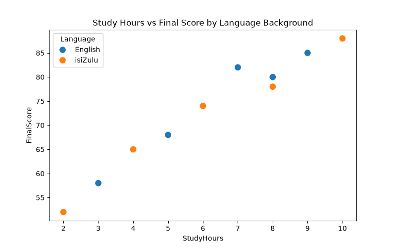
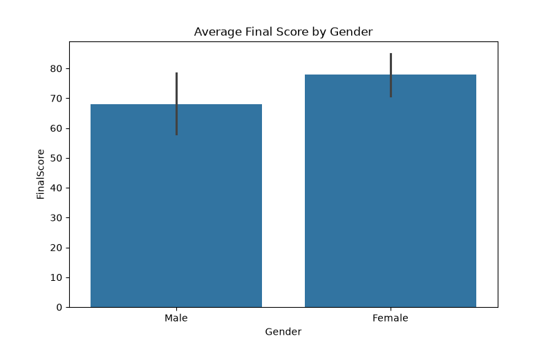

# Student Performance Analysis

### Project by Lethumusa - Data Analysis Portfolio

This project explores how study habits and language background (English / isiZulu) impact student performance.

**Key Findings:**
- Average Final Score: 73%
- Strong correlation (0.98) between Study Hours and Final Score
- No performance gap between language backgrounds when study time is equal

### Visuals

### Tools Used
Python, Pandas, Matplotlib, Seaborn

### Insights
See `insights.txt` for full insights, connecting to my research on making support more accessible.